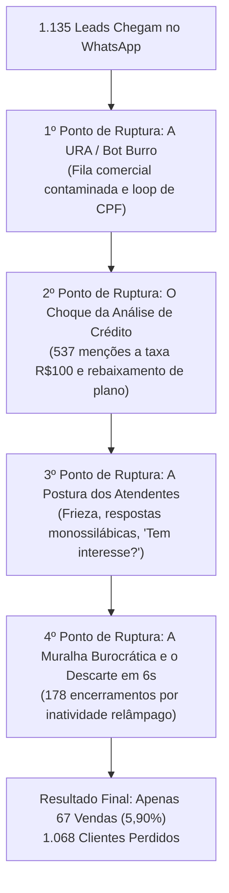

# Onde Está o Problema? Diagnóstico Forense e Autópsia do Funil Comercial da Velpro Telecom

**Mês Auditado:** Agosto de 2026 (01/08/2026 a 31/08/2026)  
**Base Analisada:** 100% dos atendimentos comerciais (1.135 conversas | 33.377 mensagens trocadas)  
**Objetivo deste Documento:** Apontar com precisão cirúrgica **onde, por que e como** as vendas morrem, desmontando a ilusão de que "o cliente não tem interesse" e expondo as falhas estruturais de processo, tecnologia e postura.

---

## 1. A Resposta Direta: Onde Está o Problema?

O problema do Comercial da Velpro Telecom **NÃO É A CAPTAÇÃO DE LEADS**. A empresa tem demanda reprimida e tráfego abundante: mais de **1.100 pessoas** buscaram contratação no WhatsApp em 31 dias.

O problema está localizado em **4 VÍCIOS ESTRUTURAIS GRAVES** que operam como uma máquina de triturar vendas:

---

## 2. A Autópsia do Funil: Onde Exatamente Cada Venda Morre?

Abaixo está o mapeamento cronológico de onde a conversa quebra, com dados percentuais e minutos de atendimento:

### Ruptura 1: O "Funil Invertido" da URA e a Poluição da Fila
* **Onde acontece:** Nos primeiros 60 segundos de contato.
* **O que acontece:** 
  - O bot interativo exige que o cliente aperte botões para informar CPF. Se o cliente apenas digita os números no teclado do WhatsApp, o bot responde repetidamente: *"Opção inválida. Escolha uma das opções abaixo."*
  - Desesperado para falar com alguém, o cliente clica na primeira opção que vê: **"🚀 Assinar Internet"** ou **"🔄 Transferência de Endereço"**.
* **Onde está a ferida:** 
  - **49 clientes da base** (querendo segunda via, suporte para internet caída ou cancelamento) caíram no Comercial em agosto.
  - Pior: o consultor de vendas perde o ânimo ao atender chamados que não são vendas e passa a atender os **verdadeiros compradores com má vontade e pressa**.

---

### Ruptura 2: A Abordagem "Fiscal de Trânsito" (Zero Sondagem)
* **Onde acontece:** Entre a 2ª e a 4ª mensagem trocada.
* **O que acontece:**
  - O cliente chega encantado: *"Olá, vi o anúncio de 1000 Mega com Wi-Fi 6"* ou *"Gostaria de saber o valor dos planos"*.
  - O atendente não dá boas-vindas calorosas, não pergunta o nome, não pergunta quantas pessoas moram na casa, nem qual é a operadora atual.
  - A resposta é um formulário seco:
    > *"Seria para qual bairro? Se possível me envia a localização fixa, por gentileza"*  
    > *(Seguido de um seco: "Atendemos")*
* **Onde está a ferida:** 
  - O cliente é tratado como um número de protocolo. Não há conexão humana, não há identificação de dor (home office, jogos, lentidão na concorrente), impedindo que o vendedor construa valor para justificar o preço.

---

### Ruptura 3: A "Bomba Atômica" no Lead: Análise de Crédito Cega e a Taxa de R$ 100 à Vista
* **Onde acontece:** Exatamente após a consulta do CPF (responsável direta pela perda de **262 clientes em agosto — 23% da base**).
* **O que acontece:**
  - Em **537 conversas** (quase metade do mês inteiro), o atendente jogou no colo do cliente uma cobrança de R$ 100,00 à vista:
    > *"Nesse cpf em nome de FULANO aprova apenas 100 megas com taxa de adesão R$100,00 a vista. O plano de 100 megas é no valor de R$89,99 e pagando até o vencimento escolhido fica por apenas R$79,99."*
* **Onde está a ferida:**
  1. **Rebaixamento humilhante:** O cliente queria 1000 Mega ou 500 Mega e o atendente diz que para ele *"aprova apenas 100 megas"*.
  2. **Inflexibilidade financeira total:** O atendente exige que R$ 100 sejam pagos em dinheiro/PIX na hora da instalação. Não oferece parcelamento, não oferece colocar na fatura de internet e não oferece consultar o CPF da esposa/marido.
  3. **Reação do vendedor à dúvida:** Quando o cliente diz *"ah, não tenho esse valor agora"* ou *"na concorrente não cobram"*, o atendente simplesmente diz: *"Tudo bem. Caso mude de ideia estaremos à disposição"*. Não há contorno de objeção. O lead é assassinado na hora.

---

### Ruptura 4: A Pergunta do Suicídio Comercial: *"Tem interesse?"*
* **Onde acontece:** No fechamento da proposta (utilizada **42 vezes**, concentrada em Tâmara Carvalho).
* **O que acontece:**
  - O atendente despeja uma proposta ou tabela e finaliza com:
    > *"Tem interesse?"*
* **Onde está a ferida:**
  - Na psicologia de vendas, essa é a pergunta mais preguiçosa e danosa existente. Ela convida o cérebro do cliente a escolher o caminho de menor esforço: dizer **"Não"** ou **ignorar**.
  - O vendedor nunca usa o fechamento alternativo (*"Você prefere a instalação no sábado pela manhã ou na segunda à tarde?"*).

---

### Ruptura 5: A "Muralha do Formulário" que Asfixia o Cliente que Queria Comprar
* **Onde acontece:** No momento em que o cliente diz "SIM, EU QUERO".
* **O que acontece:**
  - Em vez de comemorar e garantir a data, o vendedor dispara um bloco de texto intimidante:
    > *"📋 Ficha de Cadastro Velpro: E-mail, Endereço completo, 2 Telefones, Dia de vencimento, Turno, RG ou CNH frente e verso, Selfie segurando o documento, Comprovante de residência... O titular precisa estar presente."*
* **Onde está a ferida:**
  - O cliente está no trabalho ou no trânsito. Ele não tem a selfie segurando documento naquele segundo.
  - Em vez de agendar a vaga e permitir que o documento seja coletado com calma ou conferido pelo técnico na visita, os atendentes começam a pressionar: *"Olá??", "Preciso do restante dos dados", "As vagas estão se encerrando", "Deseja dar continuidade ou pode encerrar mesmo?"*.
  - O cliente se irrita com a burocracia e manda cancelar.

---

### Ruptura 6: O Escândalo do Encerramento por "Inatividade" em 6 Segundos
* **Onde acontece:** No encerramento do chamado (178 ocorrências em agosto).
* **O que os dados provaram:**
  - **A mediana do tempo de espera antes de encerrar por inatividade foi de 0,1 minuto (6 a 10 segundos).**
  - Os atendentes utilizam a ferramenta de encerramento como um botão de "limpar tela". Eles abrem uma conversa que estava aguardando retorno, colam a mensagem padrão de inatividade e clicam em fechar no mesmo instante.
  - **Zero Follow-up:** Não houve uma única mensagem de reativação enviada no dia seguinte para os **167 clientes** que ficaram inativos em agosto.

---

### Ruptura 7: O "Buraco Negro" do Fora de Horário (Pós-18h e Finais de Semana)
* **Onde acontece:** Nos 129 atendimentos recebidos à noite e fins de semana (11,4% do mês).
* **O que acontece:**
  - A mensagem automática informa friamente que o setor comercial encerrou às 18h e pede para o cliente retornar amanhã.
  - Às 08h00 do dia seguinte, esses clientes chegam acumulados. O tempo médio de espera para quem chamou à noite passa de **260 minutos (mais de 4 horas)**.
  - O cliente que pesquisou internet na quinta-feira às 19h já fechou com a concorrência na sexta às 07h da manhã. Quando a Velpro responde às 10h30, o cliente já não atende mais.

---

## 3. As Causas-Raiz: Por que a Operação Funciona Tão Mal?

Para consertar o problema, é preciso entender **de onde ele nasce**:

| Causa-Raiz | Onde Ela Reside | Como Ela Destrói o Resultado |
| :--- | :--- | :--- |
| **1. Política de Crédito Rígida e Burra** | Na Diretoria / Regra Comercial | Exigir R$ 100 à vista no ato da instalação sem opção de parcelamento em cartão ou inclusão na fatura mata metade das vendas da empresa. |
| **2. Métricas de Avaliação Distorcidas** | Na Liderança / Supervisão | Os atendentes são cobrados por "manter a tela limpa" e "tempo de tela", o que incentiva o encerramento rápido e desencoraja a negociação demorada. |
| **3. Ausência Absoluta de Treinamento em Vendas** | Nos Recursos Humanos / Comercial | Os consultores não sabem o que é SPIN Selling, não sabem o que é rapport, não sabem quebrar objeções e desconhecem técnicas de fechamento. |
| **4. Falta de Monitoria de Qualidade (QA)** | Na Gestão de Operações | Ninguém lia as conversas. Ninguém viu que atendentes digitavam anotações internas no chat do cliente ou encerravam clientes em 6 segundos. |
| **5. Ferramenta de Chat Mal Parametrizada** | No Sistema Dialogy / URA | A URA não aceita digitação natural de CPF e não tem integração para roteamento automático de clientes ativos. |

---

## 4. Conclusão do Diagnóstico de Problema

O problema comercial da Velpro Telecom é um **caso clássico de autosabotagem operacional**:
* A empresa gasta dezenas de milhares de reais atraindo pessoas pelo Meta e Google.
* O bot rejeita quem não clica nos botões e joga suporte na fila de vendas.
* O atendente recebe o interessado como se fosse um estorvo, pede localização e CPF sem falar de benefícios.
* O sistema rebaixa o plano e cobra R$ 100 à vista.
* Diante da primeira dúvida, o atendente pergunta *"Tem interesse?"*, e ao menor sinal de pausa, encerra por *"inatividade"* em 6 segundos.

O **Dossiê dos Atendentes** detalha os comportamentos individuais de Guilherme, Tâmara e Rayssa que materializam essa autosabotagem no dia a dia.
