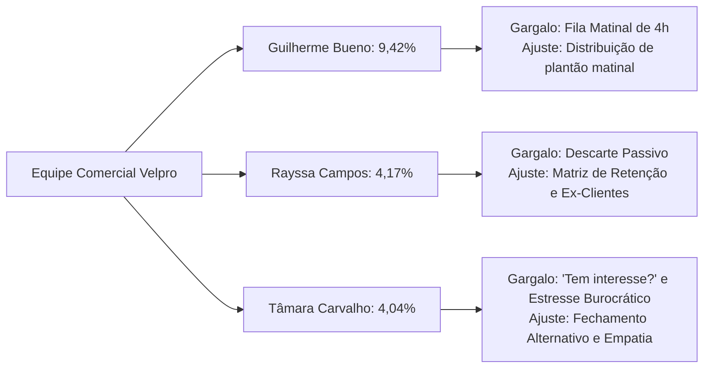

# Playbook de Reestruturação Comercial: Plano de Ação Prático para Multiplicar as Vendas de Telecom

**Empresa / Alvo:** Operação Comercial Velpro Telecom (Plataforma Dialogy)  
**Embasamento:** Auditoria Integral de 1.135 Atendimentos do Mês de Agosto de 2026  
**Meta Estratégica:** Elevar a taxa de conversão de **5,90% para 25,00%**, recuperando mais de **R$ 20.000,00/mês em nova receita recorrente (MRR)**  
**Público de Aplicação:** Gestão Comercial, Consultores (Guilherme Bueno, Tâmara Carvalho, Rayssa Campos) e Time de Pré-Vendas/Automação  

---

## 1. Diretrizes de Coaching Individualizado por Consultor

A auditoria de agosto demonstrou que cada atendente tem vícios operacionais específicos que exigem correções cirúrgicas:



### 1.1. Plano de Ajuste para Guilherme Bueno (Conversão: 9,42% | Tempo Médio: 261 min)
* **O Diagnóstico:** É o consultor com melhor argumentação e segurança técnica, fechando 39 contratos no mês. Contudo, assume a fila da noite anterior de forma desordenada, gerando um tempo médio de resposta de mais de 4 horas para quem chamou fora do horário.
* **Ajuste Obrigatório:**
  1. **Regra de Abertura Matinal (08h00 às 08h30):** Priorizar o contato com os leads da noite anterior utilizando o roteiro de reativação imediata (ver Seção 3.3).
  2. **Delegação de Fila:** Não concentrar todos os leads noturnos em um único atendente; distribuir igualmente entre Guilherme, Tâmara e Rayssa às 08h00.

### 1.2. Plano de Ajuste para Tâmara Carvalho (Conversão: 4,04% | 86 Inatividades | 40 "Tem interesse?")
* **O Diagnóstico:** É muito rápida para responder (2,8 min), mas essa agilidade se transforma em ansiedade para fechar tickets. Concentrou 95% do uso da pergunta tóxica *"Tem interesse?"*, cola mensagens idênticas em looping e induz o cliente a desistir quando falta algum documento.
* **Ajuste Obrigatório:**
  1. **Banimento Imediato do "Tem interesse?":** Substituir por Fechamento Alternativo (*"Manhã ou tarde?"*).
  2. **Proibição da Pergunta de Desistência:** Fica terminantemente proibido perguntar: *"Deseja dar continuidade ou pode encerrar mesmo?"*.
  3. **Humanização da Coleta de Documentos:** Se o cliente não tiver a foto da selfie ou comprovante no momento, garantir a data de instalação e combinar que o documento será checado pelo técnico no tablet.

### 1.3. Plano de Ajuste para Rayssa Campos (Conversão: 4,17% | 50 Inatividades | Descarte Passivo)
* **O Diagnóstico:** Converte apenas quando o cliente tem aprovação de crédito 100% perfeita. Diante de qualquer objeção de taxa (R$ 100) ou rebaixamento de plano, despede-se educadamente com *"Tudo bem, caso mude de ideia estamos à disposição"* e encerra o chamado.
* **Ajuste Obrigatório:**
  1. **Régua Obrigatória de Quebra da Taxa de Adesão:** Proibido encerrar o chamado após uma recusa de taxa sem antes oferecer: a) Consulta de CPF alternativo de familiar; b) Parcelamento no cartão em 2x; c) Data de instalação alinhada ao dia de pagamento do cliente.
  2. **Protocolo para Ex-Clientes:** Ao identificar que o cliente já teve Velpro no passado (como o Caso Andressa Luna), aplicar a abordagem de boas-vindas e resgate.

---

## 2. Blindagem e Reengenharia da Triagem (Dialogy & WhatsApp)

Com base nos 49 desvios de clientes da base e nas dezenas de leads noturnos mal processados:

### 2.1. Correção Técnica da Entrada de CPF no Bot
* **Problema Atual:** O cliente digita o CPF no teclado do WhatsApp e o bot repete *"Opção inválida. Escolha uma das opções abaixo"*, gerando frustração e fazendo o cliente clicar em "Assinar Internet" por engano.
* **Ação Imediata:** Configurar o gatilho da URA para aceitar `input de texto livre` contendo números de 11 dígitos ou formatação de CPF (`\d{3}\.?\d{3}\.?\d{3}-?\d{2}`), dispensando a obrigatoriedade de clicar no botão "Informar CPF/CNPJ".

### 2.2. Priorização Automática de Clientes Ativos
* Antes de exibir o menu comercial, o sistema deve bater o número de telefone com a base do ERP/SGP:
  - Se for **cliente ativo:** Abrir menu com `1. Fatura / Pix` | `2. Suporte / Sem Conexão` | `3. Falar com Atendente`.
  - Se for **novo lead:** Abrir jornada direta de vendas com a assistente virtual Raquel.

### 2.3. Gestão Inteligente de Leads Noturnos (18h01 às 07h59)
* Eliminar a mensagem de descarte: *"O setor comercial encerrou às 18h, retorne amanhã"*.
* A assistente virtual Raquel deve coletar:
  1. Nome e bairro;
  2. Plano desejado (500M ou 1000M);
  3. Turno preferido para o técnico ir no dia seguinte.
* Às 08h00, o consultor humano assume o chat já com o agendamento pré-pronto:
  > *"Bom dia, [Nome]! Aqui é o Guilherme da Velpro. Vi que a Raquel já reservou sua instalação de 1000 Mega para hoje à tarde. Só preciso confirmar o número da sua residência para liberar o técnico!"*

---

## 3. O Novo Roteiro de Vendas Consultivas (Passo a Passo)

### Etapa 1: Sondagem Expressa (Investigar para Conectar)
*Antes de pedir localização ou CPF, descubra o que o cliente quer resolver.*

**Mensagem do Consultor:**
> *"Olá, [Nome]! Muito bom dia. Me chamo [Nome], consultor de fibra aqui da Velpro. É um prazer falar com você! 😊*  
> *Para eu já te indicar a melhor condição de hoje: você já tem internet na sua casa ou vai instalar do zero? E quantas pessoas costumam usar Wi-Fi ao mesmo tempo?"*

---

### Etapa 2: Apresentação com Ancoragem de Valor (Fim do "Tabelão")
*Envie apenas 1 recomendação sob medida. Não envie tabela com 6 opções.*

**Se o cliente usa para trabalho, jogos ou família (4+ aparelhos):**
> *"Excelente, [Nome]! Pelo que você me descreveu, para não ter travamento e o sinal chegar forte em todos os cômodos, o plano perfeito para você é o nosso **1000 MEGA com Wi-Fi 6**.*  
> 🚀 *Ultra velocidade para filmes em 4K e reuniões simultâneas*  
> 📡 *Roteador Wi-Fi 6 de última geração incluso*  
> 🎁 *Na promoção deste mês, de ~R$ 159,90~ sai por apenas **R$ 99,90/mês** no pagamento pontual!*  
> *Me passa sua localização fixa ou rua e número para eu verificar a caixa do seu poste agora mesmo?"*

---

### Etapa 3: Tratamento de Crédito e Fim do "Aprova Apenas" (537 Casos em Agosto)
*Se o sistema exigir taxa de R$ 100 ou liberar velocidade menor, NUNCA humilhe o cliente.*

**Como NÃO dizer:**
❌ *"Nesse CPF em nome de Fulano aprova apenas 100 megas com taxa de adesão de 100 reais à vista."*

**Como DEVE ser dito (Abordagem Consultiva):**
> *"Ótima notícia, [Nome]! O sinal da nossa fibra está liberado com potência máxima no seu endereço! 🎉*  
> *Consultei aqui no sistema e o pacote liberado para ativação inicial no seu cadastro é a nossa conexão de **300 MEGA por R$ 89,90/mês**.*  
> *Para essa linha, o sistema gerou uma taxa de adesão técnica de R$ 100,00 que cobre toda a instalação da fibra até sua sala e o comodato do aparelho.*  
> *Para você já garantir essa internet sem pesar no bolso, temos duas saídas:*  
> **1)** *Podemos parcelar essa taxa em até 2x no cartão, OU*  
> **2)** *Tem algum outro familiar aí da casa cujo CPF a gente possa testar para buscar a **isenção de 100% da taxa**?"*

---

### Etapa 4: Matriz de Quebra de Objeções Prática

| Objeção mais Frequente | O que o Consultor Antigamente Dizia | O que o Consultor DEVE Responder Agora |
| :--- | :--- | :--- |
| *"A outra vez que instalei não cobraram taxa de instalação."* *(Caso Andressa)* | *"Tudo bem, caso mude de ideia estamos à disposição."* | *"Você já foi nossa cliente? Que alegria ter você de volta, Andressa! Como você já conhece nossa qualidade, deixa eu ver com a minha gerência se consigo aplicar a condição especial de 'Cliente Retorno' para isentar ou flexibilizar essa taxa para você instalar ainda hoje!"* |
| *"Na concorrência a instalação é grátis."* | *"Aqui é cobrado 100 à vista."* | *"Compreendo perfeitamente, [Nome]. A grande armadilha da concorrência é que eles não cobram na entrada, mas embutem fidelidades abusivas e colocam aparelhos velhos. A Velpro entrega fibra óptica pura com suporte que atende em minutos. Vale muito mais a pena ter paz de espírito. Vamos agendar para amanhã?"* |
| *"Não tenho 100 reais agora."* | *"Só instala pagando."* | *"Sem problemas! Qual é o melhor dia para o seu pagamento? Eu já deixo o técnico pré-agendado para a data em que você estiver com o valor em mãos, assim você não perde a vaga!"* |

---

### Etapa 5: Fechamento Alternativo Obrigatório
*A frase "Tem interesse?" está PROIBIDA.*

**Utilize sempre a Técnica da Dupla Escolha (Double Choice):**
> *"[Nome], para a equipe técnica realizar a instalação com todo cuidado, temos vagas disponíveis para **amanhã pela manhã (08h às 12h)** ou **na segunda-feira à tarde (13h às 18h)**. Qual desses turnos fica mais confortável para você estar em casa?"*

---

### Etapa 6: Coleta Cadastral Descomplicada (Fim do Estresse Burocrático)
*Não bombardeie o cliente com pedidos de 10 dados e fotos ao mesmo tempo (Caso Giselio).*

1. **Passo 1 (Reserva):** Garanta a data e o turno (*"Perfeito, sua vaga para amanhã de manhã está garantida!"*).
2. **Passo 2 (Dados em texto):** *"Para emitir sua OS, me passa só seu e-mail e a data de vencimento preferida (dia 05, 10, 15, 20 ou 25)"*.
3. **Passo 3 (Documentos flexíveis):** Se o cliente estiver na rua ou tiver dificuldade com selfie:
   > *"Fique em paz, [Nome]! O técnico leva o tablet na instalação e ele mesmo tira a foto do seu documento na hora de assinar o contrato digital. O importante é que a sua internet está confirmada!"*

---

## 4. Política Rígida de SLA e Cadência de Follow-Up (Recuperação de 167 Clientes Perdidos)

### 4.1. Proibição Terminante do Encerramento no Mesmo Dia
* É **terminantemente proibido** encerrar atendimentos comerciais por "inatividade" no mesmo dia em que o cliente entrou em contato.
* A mediana de encerramento em **6 segundos** registrada em agosto será monitorada semanalmente pela liderança. Encerramentos precipitados serão auditados como infração de procedimento comercial.

### 4.2. A Régua de 3 Toques em 48 Horas

```text
[CLIENTE PAROU DE RESPONDER]
       │
       ├─► 2 a 3 horas depois (Toque 1 - Apoio):
       │   "Oi, [Nome]! Conseguiu ver o plano de 1000 Mega que te mandei? 
       │    Fiquei na dúvida se para você era melhor a instalação no sábado ou na segunda?"
       │
       ├─► Manhã seguinte às 09h30 (Toque 2 - Rota Técnica):
       │   "Bom dia, [Nome]! Passando para te avisar que estou fechando a rota da equipe técnica 
       │    para o seu bairro hoje. Se confirmarmos até às 11h, consigo encaixar sua instalação ainda hoje!"
       │
       └─► 48 horas depois (Toque 3 - Fechamento de Porta / Escassez):
           "[Nome], como não tive mais seu retorno, estou liberando a vaga de instalação reservada 
            para outro morador da sua rua. Se ainda quiser garantir a promoção de R$ 99,90, 
            me avisa até às 18h para eu não cancelar sua reserva. Tenha uma excelente semana!"
```

---

## 5. Metas, Comissionamento e Rotina de Gestão Comercial

### 5.1. Novo Painel de Indicadores (KPIs Semanais)

| Indicador | Situação em Agosto/2026 | Meta para Setembro/Outubro | Ação Corretiva |
| :--- | :---: | :---: | :--- |
| **Taxa de Conversão Global** | **5,90%** | **≥ 22,00%** | Aplicação do script consultivo e follow-up |
| **Conversão Individual Tâmara** | **4,04%** | **≥ 20,00%** | Fim do *"Tem interesse?"* e dos 86 encerramentos precoces |
| **Conversão Individual Rayssa** | **4,17%** | **≥ 20,00%** | Aplicação da quebra de objeção de taxa e resgate de ex-clientes |
| **Tempo de 1ª Resposta em Horário Comercial** | 3,3 min | **≤ 2,0 min** | Alerta sonoro de nova oportunidade no Dialogy |
| **Taxa de Resgate por Follow-Up** | 0% (não existia) | **≥ 15,00%** | Cobrança diária do cumprimento dos 3 toques |

### 5.2. Alinhamento de Incentivos e Comissionamento
* **Substituição da Métrica de Produtividade:** A avaliação do operador não deve ser por "número de chamados encerrados", mas sim por **Contratos Ativados**.
* **Bônus por Superação de Conversão:** Criar premiação progressiva para o consultor que mantiver a taxa de conversão acima de 20% e 25% no mês.

---

## 6. Cronograma de Implantação Imediata (14 Dias)

* **Dia 1 e 2:** Reunião com Guilherme, Tâmara e Rayssa. Apresentação transparente dos dados reais de agosto de 2026.
* **Dia 3:** Ajuste técnico na URA da Dialogy (correção da digitação de CPF e blindagem de clientes ativos).
* **Dia 4 a 7:** Treinamento prático e roleplay (simulação diária de 15 minutos) do novo script, fechamento alternativo e contorno da taxa de adesão.
* **Dia 8:** Início da obrigatoriedade da régua de 3 toques de follow-up e proibição do encerramento precoce por inatividade.
* **Dia 14:** Primeira auditoria semanal de conversão e feedback individual com os consultores.
