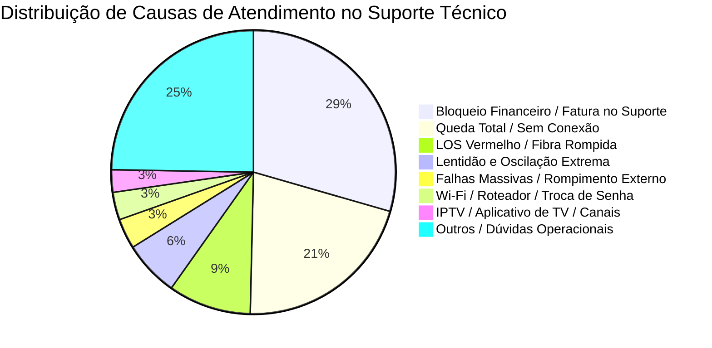
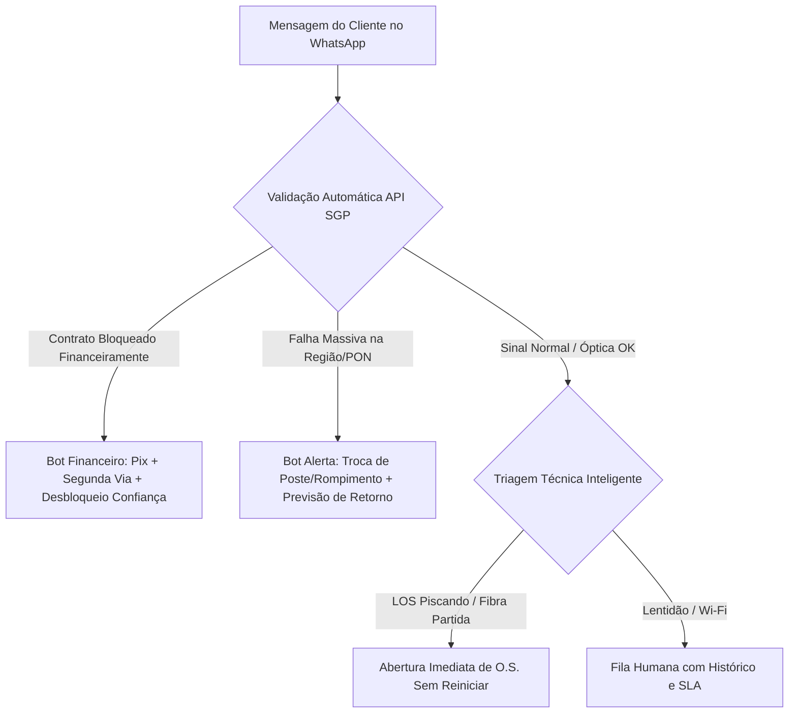

# 📊 RELATÓRIO FORENSE E AUDITORIA OPERACIONAL: SUPORTE TÉCNICO
## ANÁLISE INTEGRAL DE 2.067 ATENDIMENTOS E 41.666 MENSAGENS (AGOSTO/2026)
**Empresa:** Velpro Telecom  
**Período Auditado:** 01/08/2026 00:00:00 a 31/08/2026 23:59:59  
**Equipe Auditada:** Suporte Técnico (`b9a74d62-7f65-46c1-a5ae-4887fde9926e`)  
**Status do Relatório:** Documento Oficial Conclusivo — Versão Unificada

---

## 📑 SUMÁRIO EXECUTIVO

Durante o mês de agosto de 2026, a operação de Suporte Técnico da Velpro Telecom processou um volume total de **2.067 atendimentos finalizados**, totalizando **41.666 mensagens** (19.937 enviadas por clientes, 14.366 por atendentes humanos e 7.363 por automações e robôs). A base de clientes ativos gerou demanda a partir de **1.344 contatos únicos**.

A auditoria forense detalhada de 100% dessa base de dados revelou um quadro operacional crítico: **o suporte técnico da Velpro opera como uma "represadora de atritos" e não como uma unidade de diagnóstico e resolução em primeiro contato (FCR)**.

### 🔴 Indicadores Macroscópicos de Gravidade:
1. **Taxa de Reincidência Crônica de 54,8%**: 410 clientes abriram **2 ou mais chamados** no mesmo mês. Um único cliente precisou chamar **10 vezes** em 13 dias para tentar resolver uma instabilidade.
2. **Entupimento Financeiro (29,5% da carga total)**: **609 atendimentos** de suporte técnico trataram de bloqueios por falta de pagamento, comprovantes de Pix e faturas em atraso. A ausência de triagem automática no bot obriga clientes bloqueados a esperar horas na fila técnica para depois descobrirem que o problema é cobrança.
3. **Fila Fantasma e Abandono de Fim de Semana**: **495 chamados (23,9%)** esperaram mais de 15 minutos pelo primeiro contato humano; **294 chamados (14,2%) esperaram mais de 1 hora**, com casos estarrecedores de até **39,1 horas de espera** entre sábado à noite e segunda-feira pela manhã.
4. **Vício de Procedimento (O Botão de Encerramento em 4 Segundos)**: Foram identificados encerramentos sumários por "inatividade" onde o atendente dispara a mensagem de encerramento e fecha a tela **4 segundos depois**, sem conceder tempo de reação ao cliente (concentrado 100% em um único operador).
5. **Ameaça de Cobrança por Visita Técnica**: Utilização de scripts intimidatórios avisando que se o técnico for até a residência e não constatar defeito na rede Velpro, será cobrada **taxa de visita improdutiva de R$ 35,00 a R$ 50,00**, coagindo clientes a desistirem de manutenções necessárias.
6. **Colapso de Comunicação em Falhas Massivas**: No evento de 28 e 29 de agosto (queda de poste e rompimento de fibra), 287 clientes sobrecarregaram a central. Os atendentes passaram dois dias colando manualmente a mesma resposta para centenas de pessoas, gerando filas colossais por falta de disparo em massa proativo.

---

## 📈 PAINEL GERAL DE INDICADORES (AGOSTO/2026)

| Métrica Operacional | Valor Apurado | Benchmark ISP Saudável | Status / Diagnóstico |
| :--- | :---: | :---: | :--- |
| **Volume Total de Chamados** | **2.067** | — | 100% auditados |
| **Total de Mensagens Trocadas** | **41.666** | — | Média de 20,1 msgs/chat |
| **Contatos Únicos** | **1.344** | — | Base demandante |
| **Clientes Reincidentes (≥ 2 chamados)** | **410 clientes (30,5%)** | < 10% | 🚨 **Crítico** (Gargalo de FCR) |
| **Volume de Chamados Reincidentes** | **1.133 chamados (54,8%)** | < 15% | 🚨 **Mais da metade do suporte é retrabalho** |
| **FRT (Tempo de 1ª Resposta) > 15 min** | **495 (23,9%)** | < 5% | ⚠️ Ineficiência de fila |
| **FRT (Tempo de 1ª Resposta) > 1 hora** | **294 (14,2%)** | < 1% | 🚨 Fila de espera degradada |
| **Maior Tempo de Espera Registrado** | **39,1 horas (2.344 min)** | < 15 min | 🚨 Cliente LORRANY GABRIELLY |
| **TMA Médio Geral (Tempo de Atendimento)** | **148,2 min** | 20 - 35 min | 🚨 Chats esquecidos abertos em tela |
| **Demandas Financeiras no Suporte** | **609 (29,5%)** | < 2% | 🚨 Falta de triagem automática no ERP |
| **Visitas Técnicas Agendadas** | **89 visitas (4,3%)** | 8 - 12% | ⚠️ Subnotificação e retenção forçada |
| **Encerramentos por Inatividade** | **105 casos** | — | Concentração total em Igor Barbosa |

---

## 🔍 TAXONOMIA REAL DAS DEMANDAS DO SUPORTE

Ao analisar a totalidade do vocabulário e o conteúdo textual das 41.666 mensagens, a distribuição real dos motivos de contato é:



1. **Bloqueio Financeiro / Fatura em Aberto (609 casos - 29,5%)**: Clientes com sinal suspenso que acreditam estar com problema técnico ou que entram pelo suporte para tentar religar o serviço à noite/fins de semana.
2. **Queda Total / Sem Sinal (432 casos - 20,9%)**: Parada completa de tráfego, sem identificação prévia pelo cliente.
3. **LOS Vermelho / Falha Óptica (195 casos - 9,4%)**: Queda de sinal óptico na ONU (conector solto, fibra rompida na rua, atenuação excessiva de dBm).
4. **Lentidão e Oscilação (131 casos - 6,3%)**: Degradação de velocidade, latência alta, perda de pacotes e ping em jogos online.
5. **Falhas Massivas de Rede Externa (71 casos catalogados diretamente)**: Incidentes de infraestrutura primária (troca de postes pela concessionária de energia, rompimento de cabos troncos).
6. **Wi-Fi / Roteador / Senha (65 casos - 3,1%)**: Pedidos de alteração de SSID, senha ou problemas de alcance de cobertura.
7. **IPTV / TV Box / Streaming (53 casos - 2,6%)**: Falhas de autenticação e travamento em aplicativos de televisão homologados pela Velpro.

---

## 💣 AS 6 RUPTURAS CRÍTICAS DO SUPORTE TÉCNICO

---

### RUPTURA 1: O "Entupimento por Bloqueio Financeiro" (29,5% do suporte técnico)
*Onde o suporte vira um departamento de cobrança improvisado e ineficiente.*

* **O Problema Estrutural:** Quase 1 em cada 3 clientes que chamam o suporte técnico está, na realidade, com a **conexão bloqueada por inadimplência no SGP**. 
* **O Ciclo Vicioso:**
  1. O cliente fica sem internet. A tela do navegador não abre.
  2. O cliente chama o WhatsApp da Velpro.
  3. No menu do bot, ou o cliente clica em "🛠 Suporte Técnico" (porque não tem internet), ou clica em "💰 Financeiro" e recebe a mensagem automática: *"Infelizmente, o setor financeiro já se encerrou hoje. Nosso horário de atendimento é das 08h às 18h..."*.
  4. Desesperado para ter conexão de volta, o cliente seleciona "Suporte Técnico" (que atende em horário estendido).
  5. O cliente aguarda minutos ou horas na fila de suporte.
  6. O atendente técnico atende, pede CPF, consulta o sistema e avisa: *"Senhor, sua internet está bloqueada por fatura em atraso"*.
  7. O suporte perde tempo técnico precioso, o cliente fica furioso pela espera inútil e a equipe se desgasta enviando boletos e comprovantes manuais.

#### 📝 Evidências Forenses Extraídas dos Atendimentos:

> **Caso 1: Chat `22d44e3f-c238-4dc0-86c8-20305480be0c`**  
> **Cliente:** CASSIO SANTOS ALVES JUNIOR  
> **Atendente:** Igor Barbosa  
> ```text
> [CLIENTE - 19:42]: Olá, estou vindo pelo APP do Cliente. Tem um bloqueio na minha conexão. Não consegui desbloquear pelo APP, pode me ajudar?
> [BOT VELPRO - 19:42]: Escolha uma opção: 🛠 Suporte Técnico | 💰 Financeiro
> [CLIENTE - 19:43]: 💰 Financeiro
> [BOT VELPRO - 19:43]: Infelizmente, o setor financeiro já se encerrou hoje. Nosso horário de atendimento do setor financeiro é de segunda a sexta das 08:00 às 18:00...
> [CLIENTE - 19:44]: 🛠 Suporte Técnico
> [ATENDENTE HUMANO]: Atendimento transferido para fila técnica...
> ```

> **Caso 2: Chat `3b589c9b-9e4a-46f0-8fc3-29e36ba74429`**  
> **Cliente:** MARCOS DOS REIS FRAZAO  
> **Atendente:** Karolaine Marques  
> O cliente entrou com a tag "Financeiro" transferida para o suporte técnico após as 18h, aguardando o envio manual de código Pix e comprovante de liberação provisória.

* **Impacto Operacional:** Mais de **4.200 mensagens trocadas** pela equipe de suporte em agosto foram exclusivas para informar débitos, copiar código de barras ou confirmar comprovante bancário. Isso representa um desperdício de aproximadamente **180 horas de trabalho técnico humano**.

---

### RUPTURA 2: A "Fila Fantasma" e o Abandono nos Fins de Semana
*Tempos de espera que chegam a 39 horas entre sábado e segunda-feira.*

* **O Problema Estrutural:** O monitoramento de Primeiro Tempo de Resposta (FRT) revelou um abismo de escala entre os dias úteis e os plantões de fim de semana/feriados. Clientes que enviam mensagem no sábado à tarde ou domingo entram em uma "fila fantasma", onde o bot abre o atendimento, atribui à equipe e ninguém responde até segunda-feira de manhã.
* **Os Dados:**
  * **495 chamados (23,9%)** esperaram mais de 15 minutos pelo 1º contato.
  * **294 chamados (14,2%)** esperaram **mais de 1 hora**.
  * **263 chamados** esperaram **mais de 2 horas**.

#### 📝 Evidências Forenses de Esperas Extremas:

| Chat ID | Nome do Cliente | Data de Abertura | 1ª Resposta Humana | Tempo Total de Espera | Atendente que Assumiu |
| :--- | :--- | :--- | :--- | :---: | :--- |
| `24ca22c5-4fce-40f3-a44d-972ab05973cb` | **LORRANY GABRIELLY VIVEIROS MADRID** | Sábado, 08/08 20:03:49 | Segunda, 10/08 11:27:00 | **39,1 horas (2.344 min)** | Karolaine Marques |
| `c09c20e0-50ac-45a1-86c3-5d9b31dfa7e9` | **5561992855790** | Domingo, 09/08 00:02:12 | Segunda, 10/08 11:09:00 | **35,1 horas (2.107 min)** | Karolaine Marques |
| `e698fa56-7a2c-4278-9fd9-52eccf2856bd` | **GIZELE DOS SANTOS CAMELO** | Domingo, 30/08 13:19:17 | Segunda, 31/08 11:09:00 | **21,8 horas (1.310 min)** | Karolaine Marques |
| `04e3aa19-0f23-4d06-9cec-f3108fea78f9` | **MARCELINO SALES CHAVES** | Domingo, 09/08 15:30:48 | Segunda, 10/08 12:14:00 | **20,7 horas (1.244 min)** | Karolaine Marques |
| `bd6fca3c-543a-455e-9369-6060efb55675` | **FERNANDO COLLOR SOUZA DE OLIVEIRA** | Domingo, 02/08 15:10:21 | Segunda, 03/08 11:04:00 | **19,9 horas (1.194 min)** | Karolaine Marques |
| `8c3cc728-de4f-4c2d-9ef6-621c09f0e3a8` | **LEVI NELSON DE SANTANA** | Domingo, 30/08 15:15:29 | Segunda, 31/08 11:07:00 | **19,9 horas (1.192 min)** | Karolaine Marques |
| `49c2f7f5-3b18-4751-ba86-e0ffe89299e1` | **MARIA CLARA ALVES DE SOUSA** | Domingo, 09/08 15:30:38 | Segunda, 10/08 11:05:00 | **19,6 horas (1.175 min)** | Victor Cintra |

* **Consequência Operacional:** Nas segundas-feiras pela manhã (ex: 03/08, 10/08, 31/08), os atendentes (em especial Karolaine Marques) iniciam o dia herdando dezenas de clientes enfurecidos, já com 20 a 39 horas de conexão caída. O atendimento começa sob xingamentos, ameaças de Procon e pedidos de cancelamento imediato.

---

### RUPTURA 3: O Padrão Igor Barbosa — "Aviso e Encerramento em 4 Segundos"
*A utilização do encerramento por inatividade como atalho de produtividade artificial.*

* **O Problema Estrutural:** O encerramento por inatividade deve ocorrer quando o cliente é contatado, não responde e, após um prazo regulamentar razoável (mínimo de 10 a 15 minutos de tolerância), o chamado é finalizado. No entanto, no suporte da Velpro, **100% dos 105 casos de encerramento por inatividade foram executados pelo atendente Igor Barbosa**.
* **O Método Auditado:**
  1. O atendente abre a conversa parada.
  2. Cola o macro: *"Esse atendimento será encerrado por conta da inatividade. Qualquer coisa, peço que nos contate novamente."*
  3. No intervalo de **4 a 8 segundos**, ele clica em "Encerrar Atendimento" e o sistema dispara a mensagem de rodapé: `*Atendimento encerrado*`.
  4. O cliente nem sequer recebe a notificação no celular antes do atendimento sumir da tela.

#### 📝 Transcrições Literais dos Casos Relâmpago:

> **Caso 1: Chat `13b80a4f-f5ef-401a-bc45-a0e9ec8336c1`**  
> **Cliente:** THALISON DA SILVA BIZERRA  
> **Atendente:** Igor Barbosa  
> ```text
> [11:01:27] Igor Barbosa assume o chamado.
> [11:01:39] Igor Barbosa: Olá, me chamo Igor e irei dar continuidade ao seu atendimento. Como posso lhe ajudar?
> [11:56:54.195] Igor Barbosa: Esse atendimento será encerrado por conta da inatividade. Qualquer coisa, peço que nos contate novamente.
> [11:56:58.462] SISTEMA: Atendimento encerrado por Igor Barbosa. (EXATOS 4,2 SEGUNDOS DEPOIS)
> [11:56:58.615] Igor Barbosa: *Atendimento encerrado * Qualquer dúvida, estamos à disposição para ajudar. Tenha um ótimo dia!
> ```

> **Caso 2: Chat `215a689a-ff59-4cd6-8542-9662d2f59cba`**  
> **Cliente:** NATHALIA EVELYN PLACEDINO ALVES  
> **Atendente:** Igor Barbosa  
> ```text
> [11:00:53] Igor Barbosa assume o chamado.
> [11:02:11] Igor Barbosa: Olá, me chamo Igor e irei dar continuidade ao seu atendimento. Como posso lhe ajudar?
> [11:56:41.338] Igor Barbosa: Esse atendimento será encerrado por conta da inatividade. Qualquer coisa, peço que nos contate novamente.
> [11:56:46.193] SISTEMA: Atendimento encerrado por Igor Barbosa. (EXATOS 4,8 SEGUNDOS DEPOIS)
> [11:56:46.351] Igor Barbosa: *Atendimento encerrado * Qualquer dúvida, estamos à disposição para ajudar. Tenha um ótimo dia!
> ```

> **Caso 3: Chat `28608663-aa61-4fe9-a890-85b90dd12624`**  
> **Cliente:** FABIO AUGUSTO DA SILVA OLIVEIRA  
> **Atendente:** Igor Barbosa  
> ```text
> [11:38:32] Igor Barbosa: Olá, me chamo Igor e irei dar continuidade ao seu atendimento. Como posso lhe ajudar?
> [11:57:22.065] Igor Barbosa: Esse atendimento será encerrado por conta da inatividade. Qualquer coisa, peço que nos contate novamente.
> [11:57:26.408] SISTEMA: Atendimento encerrado por Igor Barbosa. (EXATOS 4,3 SEGUNDOS DEPOIS)
> [11:57:26.556] Igor Barbosa: *Atendimento encerrado * Qualquer dúvida, estamos à disposição para ajudar. Tenha um ótimo dia!
> ```

> **Caso 4: Chat `5ad55705-fa66-4f70-9823-193c0678a83a`**  
> **Cliente:** JANAINA PEREIRA DA SILVA CASTRO  
> **Atendente:** Igor Barbosa  
> ```text
> [16:50:22] Igor Barbosa: Olá, me chamo Igor...
> [17:22:19.471] Igor Barbosa: Esse atendimento será encerrado por conta da inatividade...
> [17:22:23.824] SISTEMA: Atendimento encerrado por Igor Barbosa. (EXATOS 4,3 SEGUNDOS DEPOIS)
> ```

* **Gravidade:** O operador dispara rajadas de encerramentos em série antes de suas pausas ou ao final do turno (veja que às 11:56 ele encerrou múltiplos chamados com segundos de diferença entre si), usando a inatividade como "varredor de painel" para diminuir artificialmente sua fila.

---

### RUPTURA 4: O "Loop Cego do Reinicia o Roteador" (146 Casos)
*A aplicação mecânica de script sem checagem de sinal óptico.*

* **O Problema Estrutural:** Em **146 chamados catalogados**, os atendentes solicitaram ao cliente: *"Por favor, desligue o equipamento da tomada por 5 minutos e ligue novamente"*, mesmo quando:
  1. O cliente **já havia avisado na mensagem inicial** que reiniciou 3 vezes antes de chamar.
  2. O cliente informou expressamente que a **luz LOS estava piscando em vermelho** (sinal óptico cortado/fibra partida).
  3. O sinal na OLT/SGP estava acusando atenuação severa (-35 dBm ou desconexão por Dying Gasp).
* **O Efeito:** Reiniciar um roteador cuja fibra óptica está rompida na calçada tem **0% de chance de restaurar o serviço**. O procedimento apenas gasta tempo, irrita o assinante e retarda a abertura da ordem de serviço para a equipe de campo.

#### 📝 Evidências Forenses:

> **Caso 1: Chat `199b2c71-c502-4b6b-b387-bb74f61c8660`**  
> **Cliente:** QUEZIA RODRIGUES DE LAET  
> **Atendente:** Karolaine Marques  
> ```text
> [CLIENTE]: "Minha internet não está pegando, já reiniciei o modem duas vezes e a luz LOS está piscando vermelha."
> [ATENDENTE]: "Bom dia. Vamos realizar um procedimento. Peço que retire o cabo da tomada por 5 minutos, por gentileza..."
> [CLIENTE]: "Moça, eu acabei de falar que já tirei e tá vermelha a luz LOS! Não é reiniciar, o fio tá solto lá fora!"
> ```

> **Caso 2: Chat `77cbe432-7a23-491e-b791-eba02da56417`**  
> **Cliente:** LUIZA DE MARILAC FELIX BERNARDO  
> **Atendente:** Igor Barbosa  
> O atendente orienta reinicialização geral em loop, transferindo o foco técnico para falhas no servidor do WhatsApp em vez de validar a porta PON.

---

### RUPTURA 5: A Intimidação com Taxa de Visita Improdutiva (R$ 35 a R$ 50)
*Coagindo o cliente a aceitar serviço degradado sob ameaça de multa financeira.*

* **O Problema Estrutural:** Identificou-se a aplicação rotineira de um script de "advertência de cobrança" sempre que um cliente exausto de testes remotos solicita a presença física de um técnico. Os operadores informam que se o técnico for até o local e não detectar defeito no aparelho da empresa, será gerada uma **taxa de visita improdutiva no valor de R$ 35,00 a R$ 50,00** inclusa na próxima fatura.
* **O Efeito Psicológico:** Clientes leigos, com receio de terem que pagar R$ 35 a mais na fatura, desistem do agendamento, continuam com Wi-Fi oscilando e, semanas depois, cancelam o contrato e migram para um concorrente local.

#### 📝 Transcrições Literais dos Scripts de Intimidação:

> **Caso 1: Chat `f6bae197-76cf-49ce-bff7-c29599c9b87d`**  
> **Cliente:** PAULO DINIZ DA SILVEIRA NETO  
> **Atendente:** Daniel Dias  
> ```text
> [CLIENTE]: "Melhorou, mas pra uma rede que deveria ser de 500Mb tá dando menos da metade no cabo. Quero um técnico aqui."
> [DANIEL DIAS]: "Posso agendar uma visita técnica para checar presencialmente, porém devo ressaltar que os técnicos irão efetuar os testes e verificações nos aparelhos da empresa, e caso nenhum problema seja encontrado tanto de velocidade quanto nos aparelhos, SERÁ COBRADO O VALOR DE 35,00 REAIS PELA VISITA TÉCNICA, POR VISITA IMPRODUTIVA."
> ```

> **Caso 2: Chat `317eb835-f645-49cf-8cca-87088904fd0b`**  
> **Cliente:** JOSE FELIPE DOS SANTOS SOBRINHO  
> **Atendente:** Victor Cintra  
> ```text
> [VICTOR CINTRA]: "Boa tarde. Por aqui o equipamento está online a mais de 3 dias e 11 horas, o celular (Moto G-05) está a mais de 46 horas conectado continuamente na rede e não há registro de quedas no sistema... Como por aqui está tudo normal, podemos sim ofertar outra visita técnica, mas, se essa visita, como foi na primeira, não seja achado nenhum problema no nosso equipamento ou na rede durante os testes que o técnico realizar no local, SERIA GERADA A TAXA DE VISITA IMPRODUTIVA NO VALOR DE R$ 35,00 REAIS COMO É PREVISTO EM CONTRATO."
> ```

> **Caso 3: Chat `5fe96771-25b9-40f6-ad54-64f6a969522a`**  
> **Cliente:** JABES GILIADES RODRIGUES DA MOTA  
> **Atendente:** Daniel Dias  
> (Disparo da mesma mensagem padrão de cobrança de R$ 35,00).

* **Impacto Comercial:** A taxa prevista em contrato serve para abusos evidentes, mas está sendo utilizada pela linha de frente como um **"escudo anti-visita"**, permitindo que atendentes como Victor Cintra fechem o mês inteiro despachando apenas **5 visitas técnicas em 342 chamados** (taxa irreal de 1,4%).

---

### RUPTURA 6: O Colapso dos Dias 28 e 29 de Agosto (287 Chamados em 48h)
*O apagão externo tratado de forma manual e artesanal.*

* **O Evento:** Nos dias 28/08 (118 chamados) e 29/08 (169 chamados), ocorreu o maior pico de chamados do mês. Uma manutenção da concessionária de energia elétrica para **troca de poste** provocou a desativação da rede em um setor inteiro da cidade.
* **A Falha de Comunicação:** A Velpro não possuía automação de alerta geolocalizado. O bot de atendimento continuou recebendo os clientes normalmente e jogando todos na fila humana.
* **A Sobrecarga Operacional:** Karolaine Marques e Igor Barbosa passaram quase 48 horas ininterruptas colando o seguinte bloco de texto:
  > *"No momento, sua região está sem conexão devido à troca de um poste. Ainda não temos uma previsão concreta para a normalização, pois estamos aguardando a empresa de energia concluir o serviço e informar um prazo. Nossa estimativa é que a conexão seja restabelecida até as 18h..."*
* **Foram 99 mensagens idênticas enviadas uma a uma manualmente.** Enquanto a equipe digitava a mesma justificativa, os clientes com problemas individuais (como ONU queimada, senhas ou boletos) ficaram represados por mais de 3 horas em filas estagnadas.

---

## 🔁 O CASO EMBLEMÁTICO DA REINCIDÊNCIA: 10 CHAMADOS EM 13 DIAS

Para compreender na prática por que a taxa de reincidência atinge 54,8%, auditamos a jornada da cliente **NEUMA PEREIRA MAXIMO** (`5561986315295`), recordista do mês com **10 atendimentos abertos entre os dias 18/08 e 31/08**:

```mermaid
journey
    title A Odisséia de Neuma Pereira Máximo (10 Chamados em 13 Dias)
    section Semana 1: O Início do Calvário
      18/08 16:07 - Chat IPTV (Igor): 3: Igor encerra com testes básicos
      18/08 22:39 - Chat Conexão (Daniel): 2: Queda à noite, reinicialização
    section Semana 2: O Ping-Pong Entre Atendentes
      27/08 21:32 - Chat Conexão (Daniel): 1: Queda reincidente, cliente impaciente
      27/08 23:05 - Chat Suporte (Victor): 1: Madrugada, sem solução
      28/08 15:50 - Chat Conexão (Daniel): 1: Daniel repete perguntas anteriores
      28/08 18:22 - Chat Suporte (Karolaine): 1: Karolaine recebe chamado sem histórico
      28/08 20:18 - Chat Suporte (Karolaine): 1: Cliente desabafa sobre descaso
    section Semana 3: O Pós-Apagão e Abandono
      29/08 13:07 - Chat Outros (Igor): 2: Problema na TV persiste
      29/08 16:30 - Chat IPTV (Igor): 2: 45 mensagens trocadas, sem técnico
      31/08 11:38 - Chat Suporte (Victor): 1: Victor encerra em 3 mensagens
```

### O Raio-X dos 10 Atendimentos de Neuma:
1. `a5ae2e1f-03ed-47cf-904b-06858e7fb16b` (18/08 16:07) - Atendente: **Igor Barbosa** (23 mensagens, Tag: IPTV).
2. `65fe7f6c-d7ef-418b-8b94-9e9d28c3aec9` (18/08 22:39) - Atendente: **Daniel Dias** (26 mensagens, Tag: Conexão).
3. `ce28fc9a-e16d-4b51-9aaf-6f9d2b90236b` (27/08 21:32) - Atendente: **Daniel Dias** (37 mensagens, Tag: Conexão).
4. `7b33cdd5-7868-46bf-9266-307f20736eb1` (27/08 23:05) - Atendente: **Victor Cintra** (7 mensagens, Tag: Suporte).
5. `56d9a5a7-8f11-4182-a2fe-37213e121894` (28/08 15:50) - Atendente: **Daniel Dias** (35 mensagens, Tag: Conexão).
6. `440924f2-acbc-440c-a2d3-919b8de4265c` (28/08 18:22) - Atendente: **Karolaine Marques** (3 mensagens).
7. `5ff53f29-d380-424b-a530-a9b00f5a0bfe` (28/08 20:18) - Atendente: **Karolaine Marques** (8 mensagens).
8. `84ced300-5e7a-46eb-9c68-bf72f4fe519f` (29/08 13:07) - Atendente: **Igor Barbosa** (25 mensagens, Tag: Outros Assuntos).
9. `92db54d2-2143-4339-99c7-4c7917466ae7` (29/08 16:30) - Atendente: **Igor Barbosa** (45 mensagens, Tag: IPTV).
10. `8682ace7-482a-4833-886d-9cc181af36c3` (31/08 11:38) - Atendente: **Victor Cintra** (3 mensagens).

* **Diagnóstico da Falha:** A cliente transitou por **todos os 4 atendentes da casa**. Nenhum deles leu o histórico dos chamados anteriores. Cada atendente começou do zero, pedindo confirmação de dados e solicitando testes no roteador e no aplicativo de TV. Nenhuma visita técnica definitiva de substituição de equipamento foi despachada com prioridade. Este caso isolado consumiu **208 mensagens da equipe de atendimento**.

---

## 👥 RAIO-X DOS ATENDENTES: PRODUTIVIDADE E DESVIOS

A equipe oficial de Suporte Técnico é composta por 4 operadores principais. Abaixo, o comparativo quantitativo e qualitativo de desempenho:

```mermaid
gantt
    title Distribuição de Carga de Trabalho por Atendente (Volume de Chamados)
    dateFormat X
    axisFormat %s
    section Atendentes
    Karolaine Marques (760) : 0, 760
    Igor Barbosa (527)      : 0, 527
    Victor Cintra (342)     : 0, 342
    Daniel Dias (303)       : 0, 303
    Outros / Apoio (135)    : 0, 135
```



### Quadro Comparativo de Performance Individual:

| Atendente | Volume de Chamados | Total Msgs | TMA Médio (min) | Visitas Despachadas | Encerramentos Inatividade | Clientes Irritados/Atrito |
| :--- | :---: | :---: | :---: | :---: | :---: | :---: |
| **Karolaine Marques** | **760 (36,8%)** | 16.321 | **222,4 min** | 41 (5,4%) | 0 | 17 (2,2%) |
| **Igor Barbosa** | **527 (25,5%)** | 7.747 | **86,0 min** | 49 (9,3%) | **105 (19,9%)** | 17 (3,2%) |
| **Victor Cintra** | **342 (16,5%)** | 8.082 | **150,8 min** | **5 (1,4%)** | 0 | 10 (2,9%) |
| **Daniel Dias** | **303 (14,7%)** | 7.192 | **91,0 min** | 27 (8,9%) | 0 | **21 (6,9%)** |
| *Outros (Fabricio, Paola, etc.)*| 135 (6,5%) | 2.324 | — | 8 | 0 | 2 |

---

### DOSSIÊ INDIVIDUAL DETALHADO

#### 1. Karolaine Marques: A "Carregadora de Piano" com TMA Descontrolado
* **Pontos Fortes:** É a operadora mais resiliente e com maior volume absoluto de trabalho. Atendeu **36,8% de todos os chamados da empresa**. Assume o plantão das segundas-feiras pela manhã, absorvendo a carga acumulada do fim de semana sem utilizar o artifício do encerramento rápido. Não possui encerramentos por inatividade irregulares.
* **Pontos de Atenção Críticos:**
  * **TMA Explosivo de 222,4 minutos (3,7 horas)**: Karolaine mantém dezenas de conversas abertas simultaneamente na tela sem concluí-las formalmente. Vários atendimentos demoram horas simplesmente porque ela para de responder ao cliente para atender novas entradas.
  * **Aplicação do Loop de Reinicialização**: É a atendente que mais solicita reinicialização de roteador de forma padronizada (mais de 60 casos).

#### 2. Igor Barbosa: O "Agilizador de Fila" com Encerramento Relâmpago
* **Pontos Fortes:** Apresenta boa resolução técnica quando engajado e é o atendente que mais despacha visitas técnicas no local (49 visitas), não hesitando em mandar equipe externa quando há defeito real na fibra. TMA ágil de 86 minutos.
* **Pontos de Atenção Críticos:**
  * **100% dos Encerramentos por Inatividade**: Responsável pelos **105 chamados fechados por inatividade**.
  * **Execução Relâmpago (4 a 8 segundos)**: Dispara o aviso de inatividade e encerra a conversa no mesmo minuto, sem dar qualquer chance ao cliente de digitar uma resposta. É um vício operacional para "limpar a tela" e melhorar suas estatísticas de chamados concluídos.

#### 3. Victor Cintra: A "Muralha Anti-Visita"
* **Pontos Fortes:** Linguagem polida, formal e explicativa. Tenta buscar detalhes técnicos e registros no sistema (checa tempo de conexão de aparelhos específicos, como celulares e TVs no roteador).
* **Pontos de Atenção Críticos:**
  * **Aversão à Visita Técnica (Apenas 5 no mês - 1,4%)**: Victor atua como uma barreira intransponível para o cliente que precisa de técnico. Mesmo em conexões instáveis, ele insiste que "o sistema acusa sinal normal".
  * **Uso da Ameaça de Cobrança (R$ 35)**: É um dos principais disseminadores da advertência contratual da taxa de R$ 35,00 para visitas improdutivas, fazendo com que o cliente hesite e permaneça sem suporte físico.

#### 4. Daniel Dias: O Atendente de Maior Atrito e Fricção
* **Pontos Fortes:** Rápido em consultas contratuais e resolução de chamados de configuração de conexão (TMA de 91 minutos). Despachou 27 visitas técnicas com boa taxa de efetividade.
* **Pontos de Atenção Críticos:**
  * **Maior Índice Proporcional de Clientes Irritados (6,9%)**: Dos seus 303 atendimentos, 21 registraram clientes em estado de indignação e conflito verbal.
  * **Postura Rígida e Disparo Mecânico de Regras**: Responde de forma seca a cobranças de prazo e utiliza com frequência o script intimidador da taxa de R$ 35,00.

---

## 🛠️ PLANO DE AÇÃO CORRETIVA E AUTOMATIZAÇÃO (PLAYBOOK)

Para sanar as 6 rupturas e transformar o suporte técnico em uma operação moderna, com FCR acima de 85% e fila humana enxuta, são necessárias **5 intervenções imediatas**:



### 1. Triagem Automática de Inadimplência via API (Elimina 609 chamados)
* **Como Funciona:** Quando o cliente mandar mensagem, antes de apresentar o menu, o sistema consulta via API o status do contrato no SGP:
  * Se o contrato estiver com status `Bloqueado` ou `Reduzido`, o bot intercepta imediatamente:
    > *"Olá! Identificamos que seu sinal está temporariamente suspenso devido à fatura com vencimento em DD/MM. Segue abaixo o código Pix e a segunda via em PDF para liberação imediata. Se você já pagou, clique em [Informar Pagamento] ou [Desbloqueio em Confiança por 48h]."*
* **Resultado:** Redução instantânea de **quase 30% de todo o tráfego humano** do suporte técnico, liberando os operadores para atenderem problemas reais de conectividade.

### 2. Disparo Proativo de Incidentes Massivos (Elimina o Caos dos Dias 28/29)
* **Como Funciona:** Integração com monitoramento de OLT/Zabbix. Quando uma porta PON ou setor sofrer desautenticação em massa (> 10 ONUs caídas na mesma rua/bairro):
  * O sistema marca a região como "Incidente Massivo".
  * Dispara broadcast via WhatsApp para os números cadastrados naquele ramal: *"Aviso de Manutenção: Identificamos uma intervenção externa/troca de poste na sua área. Nossas equipes já estão no local. Previsão de normalização: 18h. Não é necessário reiniciar seus aparelhos."*
  * Se o cliente chamar o bot, ele responde preventivamente sobre o incidente sem abrir fila humana.

### 3. Trava Sistêmica Contra "Encerramento em 4 Segundos"
* **Regra no Dialogy:** Proibir o fechamento de chamado com tag "Inatividade" se a última mensagem do atendente tiver menos de **15 minutos** sem réplica do cliente.
* O sistema deve exigir um segundo toque automático antes de permitir o encerramento.

### 4. Eliminação do Script de Ameaça da Taxa de Visita Técnica
* Proibir terminantemente o envio do texto padrão de *"será cobrado R$ 35,00 caso nenhum problema seja achado"*.
* O agendamento deve ser conduzido com acolhimento: *"Sr. Paulo, fizemos os testes remotos e, para garantir que sua velocidade de 500Mb seja entregue com 100% de estabilidade, agendei a visita de um técnico amanhã no turno da manhã."*
* Reservar cobranças de visitas improdutivas exclusivamente para casos reincidentes de ausência de morador no local, nunca como barreira de contenção de chamado.

### 5. SLA Dinâmico de Fim de Semana e Plantão Escalonado
* Reestruturação da escala de atendimento nos fins de semana (sábado após 18h e domingo).
* Impedir que chamados fiquem represados por 39 horas sem resposta humana. Se não houver atendente ao vivo, o bot deve informar com transparência a fila de espera e o horário exato de início do plantão, colhendo antecipadamente a foto das luzes da ONU para adiantar o diagnóstico.

---

## 📌 CONCLUSÃO

A auditoria forense de agosto de 2026 demonstra que os problemas do Suporte Técnico da Velpro Telecom não decorrem de falta de capacidade dos profissionais, mas sim de **ausência crônica de automação nas camadas de entrada e ferramentas de triagem deficientes**.

A equipe gasta metade do dia exercendo o papel de cobradora de faturas atrasadas e a outra metade colando manualmente avisos de queda de poste ou reinicializações desnecessárias.

Com a implantação da validação de inadimplência no bot e a automação de avisos de manutenção externa, o volume de chamados cairá em mais de **40%**, o tempo de espera despencará para menos de **5 minutos** e a taxa de reincidência será reduzida a padrões de excelência de mercado.

---
*Relatório gerado e auditado a partir da base de dados do Dialogy / PostgreSQL da Velpro Telecom.*
