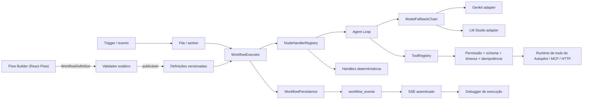
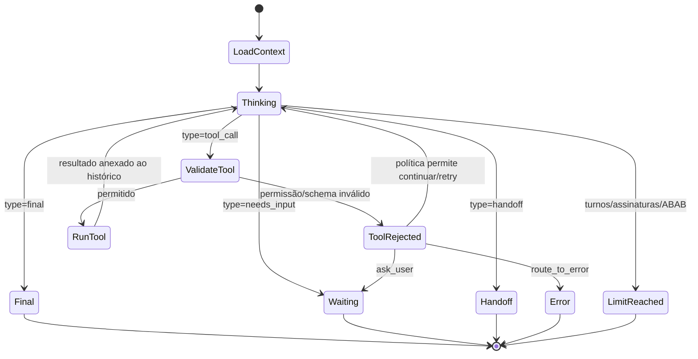

# Nova arquitetura do Flow Builder e runtime de agentes

Status: fundação implementada em 2026-07-02.

Este documento descreve o motor genérico criado em `src/services/workflow-runtime`. O Autopilot continua sendo a superfície de produto; o novo módulo passa a ser o núcleo reutilizável que controla estado, execução, tools, modelos, eventos e persistência.

## 1. Diagnóstico da arquitetura anterior

O sistema existente já possuía recursos importantes — versionamento de agentes, leases de chat, claims duráveis de tools, procedimentos, RAG, auditoria e um canvas em React Flow. O problema era a ausência de um contrato comum entre essas peças.

Problemas concretos encontrados:

1. `AutopilotFlowGraph` descrevia principalmente a aparência e uma lista curta de blocos do atendimento. Não representava timeout, retry, schemas, portas ou limites globais.
2. O significado de uma conexão era inferido pelos tipos dos blocos e pelos handles do React Flow. `main`, `tool`, `knowledge`, `model`, `memory`, `guardrail`, `error` e `event` não eram persistidos como contratos distintos.
3. O runtime conversacional mantinha decisões distribuídas entre `process-chat`, procedure runtime, turn policy, tool planner e prompts. Não existia um executor universal que recebesse qualquer nó e exigisse exatamente um `NodeExecutionResult`.
4. O ponteiro da execução era parcialmente derivado do estado da conversa e do procedimento. Isso dificultava pausa genérica, retomada após reinício, replay e execução a partir de um bloco.
5. `orchestrator_runs`, `procedure_executions`, chat leases e tool claims eram úteis, mas não formavam uma entidade única de `WorkflowExecution`.
6. O loop de IA não era um componente isolado com `maxTurns`, assinatura de decisão, detecção ABAB e política uniforme de limite.
7. O adaptador anterior de LM Studio misturava configuração do provider, prompt e parsing específico do Autopilot. O novo adapter não depende do nicho.
8. O gate de publicação era forte para os fluxos atuais, mas continha regras específicas do atendimento. Faltava um validador estático genérico do grafo.
9. O canvas já distinguia conhecimento e ferramenta visualmente, porém o tipo da conexão não fazia parte do grafo persistido.
10. Não existia uma tela genérica que consumisse eventos duráveis e mostrasse input, output, `statePatch`, estado anterior/posterior e tool calls.

## 2. Decisão arquitetural

A implementação principal é uma máquina de estados orientada a eventos, executada por workers stateless.

- O workflow visual é uma definição imutável e versionada.
- `WorkflowExecutor` mantém o ponteiro e decide a próxima conexão.
- Cada handler executa uma vez e retorna `NodeExecutionResult`.
- O modelo produz decisões; não move o workflow nem executa tools.
- `WorkflowPersistence` é a autoridade sobre estado, lock, retomada e histórico.
- Eventos são gravados antes de alimentar SSE, debugger ou observabilidade.
- Componentes anexos (`model`, `tool`, `memory`, `knowledge`, `guardrail`) não entram automaticamente no caminho linear.



## 3. Separação de responsabilidades

| Componente | Responsabilidade | Não faz |
| --- | --- | --- |
| Definição visual | Nós, posições, portas, conexões e settings | Não executa |
| Runtime | Estado, transições, limites, retries e retomada | Não decide conteúdo de negócio |
| Modelo | Geração ou decisão estruturada | Não chama sistemas externos |
| Agent Loop | Orquestra turnos modelo → decisão → tool → resultado | Não altera o ponteiro do workflow |
| Tool | Uma capacidade tipada e autorizada | Não escolhe a próxima etapa |
| Memória | Recupera/persiste fatos conforme política | Não recebe o histórico bruto ilimitado |
| RAG | Recupera documentos relevantes dentro do orçamento | Não preenche contexto com documentos irrelevantes |
| Estado | `variables`, `context`, resultados e caminho | Não vive apenas no processo |
| Evento | Registro operacional seguro | Não expõe chain-of-thought |
| Persistência | Definições, execuções, locks, passos e eventos | Não decide rotas |
| Interface | Edição, validação e depuração | Não simula sucesso inexistente |

## 4. Estrutura de diretórios

```text
src/services/workflow-runtime/
├── adapters/
│   ├── genkit.ts
│   ├── genkit-flows.ts
│   └── lm-studio.ts
├── agent-loop.ts
├── autopilot-compat.ts
├── autopilot-tool-bridge.ts
├── catalog.ts
├── events.ts
├── executor.ts
├── index.ts
├── model-adapter.ts
├── model-capability-store.ts
├── node-handlers.ts
├── persistence.ts
├── postgres-persistence.ts
├── schemas.ts
├── tools.ts
├── types.ts
├── utils.ts
└── validator.ts

src/components/workflow/
└── workflow-execution-debugger.tsx

src/app/api/workflows/executions/[executionId]/
├── route.ts
└── events/route.ts

src/app/autopilot/executions/[executionId]/
└── page.tsx

prisma/migrations/20260702140000_workflow_runtime_v2/
└── migration.sql
```

## 5. Contratos TypeScript e Zod

Os contratos ficam em `schemas.ts`; os tipos são inferidos em `types.ts`. Não existe uma interface TypeScript sem validação equivalente em runtime para os objetos centrais.

Principais schemas:

- `WorkflowDefinitionSchema`
- `WorkflowNodeSchema`
- `WorkflowConnectionSchema`
- `WorkflowExecutionSchema`
- `NodeExecutionResultSchema`
- `AgentNodeConfigSchema`
- `AgentDecisionSchema`
- `ModelConfigurationSchema`
- `ModelCapabilityProfileSchema`
- `WorkflowValidationResultSchema`

Invariantes aplicados pelo schema:

- `error` exige erro padronizado.
- `waiting` exige `resumeToken`.
- Um resultado não pode retornar `selectedOutput` e `selectedOutputs` simultaneamente.
- Limites, timeouts e tentativas precisam ser positivos e limitados.
- Portas declaram direção, cardinalidade e tipo de conexão.

`selectedOutputs` é uma extensão controlada para `logic.parallel`; o executor rejeita seu uso em outros tipos.

## 6. Catálogo de blocos

`catalog.ts` registra mais de 40 manifests, organizados em:

- Gatilhos
- Dados
- Lógica
- IA
- Conhecimento e memória
- Ferramentas
- Saída
- Erro

Cada manifest define:

- label e descrição para pessoas não técnicas;
- categoria, ícone e tom visual;
- portas de entrada e saída;
- configuração inicial;
- timeout e retry padrão;
- se é anexo, terminal, sensível ou exige rota de erro.

O catálogo contém os blocos do briefing: triggers, Set, Transform, Extract, Code, Template, IF, Switch, AI Router, Merge, Loop, For Each, Parallel, Wait, Subflow, Model, Prompt, Agent, Supervisor, Evaluator, Planner, Plan Executor, RAG, memórias, state load/save, tools HTTP/database/internal/MCP/subflow, guardrail, Respond, Handoff, End e Error Handler.

## 7. Runtime de execução

Fluxo de `WorkflowExecutor.start()`:

1. Valida o workflow.
2. Persiste a definição/versionamento.
3. Cria `WorkflowExecution` com o trigger como `currentNodeId`.
4. Emite `execution.started`.
5. Obtém lock com lease.
6. Executa um nó por vez por `executeNodeSafely`.
7. Valida config, input e output.
8. Aplica `statePatch` em `variables`, bloqueando prototype pollution.
9. Persiste resultado, caminho, contadores e próximo nó.
10. Emite eventos operacionais.
11. Libera o lock ao terminar, aguardar, falhar ou cancelar.

`executeNodeSafely`:

- cria timeout com `AbortController`;
- converte exceções em erro padronizado;
- aplica retry exponencial somente a erros elegíveis;
- registra tentativa e duração;
- sempre retorna ou lança para o executor encerrar o estado do nó;
- nunca deixa um nó apenas como `running`.

O executor implementa:

- fluxo linear;
- IF e Switch;
- paralelismo com fila determinística e barreira no Merge;
- pausa e retomada por token;
- cancelamento;
- error routes;
- limite de passos, duração, modelo, tools e tokens;
- lock por worker;
- optimistic concurrency por `version`.

## 8. Agent Loop

`agent-loop.ts` mantém o loop fora do prompt.



Proteções:

- objetivo e critérios obrigatórios;
- tool precisa de nome, descrição e schema;
- somente tools registradas;
- argumentos e saída validados;
- tool result nunca é inventado;
- assinatura SHA-256 de decisão e estado relevante;
- contagem separada de mesma tool + mesmos argumentos;
- redirecionamento de estratégia antes do corte;
- detecção de alternância ABAB sem mudança de estado;
- limite de turns/model calls/tool calls;
- validação do output final quando schema é obrigatório;
- nenhum prompt solicita ou exibe chain-of-thought.

Eventos `agent.thinking.started` e `agent.thinking.finished` delimitam exatamente a chamada ativa ao modelo.

## 9. Genkit

`GenkitModelAdapter` usa a API estável `ai.generate`/`ai.generateStream`.

`defineWorkflowAgentDecisionFlow` registra um flow reutilizável, com:

- input Zod;
- output `AgentDecisionSchema`;
- structured output;
- trace do flow e da geração;
- erro técnico quando o modelo não devolve output.

O runtime não delega o ponteiro do grafo ao Genkit. Genkit permanece a camada de geração, tipagem, flows e tracing.

## 10. LM Studio

`LmStudioModelAdapter` usa endpoints OpenAI-compatible:

- `GET /v1/models`
- `POST /v1/chat/completions`
- streaming SSE de chat completions
- `response_format.type = json_schema`
- `tools` no formato de function calling quando solicitado

O adapter:

- normaliza base URL;
- aplica timeout/cancelamento;
- nunca retorna `reasoning_content` como resposta;
- transforma tool requests em dados, sem executá-las;
- valida JSON e Zod;
- marca JSON/schema inválidos como erro técnico elegível a fallback;
- consulta perfis de capacidade testados;
- não habilita tools/structured output para modelo sem perfil.

Perfis ficam em `workflow_model_capabilities` e são acessados por `ModelCapabilityStore`.

## 11. Fallback de modelo

`ModelFallbackChain` tenta candidatos em ordem.

Fallback só ocorre para:

- modelo indisponível;
- timeout;
- rede/upstream;
- JSON inválido;
- saída que falhou no schema.

Erro de capacidade ou regra comportamental não faz fallback silencioso.

O resultado registra candidato selecionado e tentativas. O hook `onFallback` permite emitir auditoria, métrica ou aviso de mudança de modelo.

## 12. Sistema de tools

`ToolRegistry.executeSafely()` executa a sequência:

1. tool permitida;
2. input Zod;
3. permissão/confirmação;
4. idempotency key;
5. timeout;
6. retry elegível;
7. output Zod;
8. limite de bytes;
9. evento e registro estruturado.

`autopilot-tool-bridge.ts` adapta o catálogo e o runtime existentes:

- mantém a policy gate do Autopilot;
- mantém durable tool claims;
- mantém confirmação pendente;
- mantém auditoria atual;
- traduz `mcp:<server>:<tool>` para a ação MCP existente;
- devolve somente resultado confirmado ao Agent Loop.

## 13. Persistência

Migration criada:

- `workflow_definitions`
- `workflow_executions`
- `workflow_node_runs`
- `workflow_tool_calls`
- `workflow_events`
- `workflow_model_capabilities`

`workflow_executions` persiste o snapshot necessário para retomada:

- nó atual/anterior;
- fila de ramificações;
- input, variables e context;
- resultados;
- caminho;
- motivo/token de espera;
- falha;
- contadores;
- lock e versão.

`PostgresWorkflowPersistence.saveExecution()` usa `WHERE id = ? AND version = ?`, incrementando a versão. Uma atualização concorrente gera `WorkflowOptimisticLockError`.

O lock aceita takeover somente quando expirado. A execução em `waiting` não depende de timers em memória e é encontrada por índice único de `resume_token`.

## 14. Eventos e streaming

Eventos duráveis:

- execução iniciada, retomada, esperando, concluída, falha ou cancelada;
- nó em fila, iniciado, retry, concluído ou falho;
- agent thinking start/finish/limit;
- tool requested/started/completed/failed/rejected;
- message delta.

`WorkflowEventBus`:

- atribui sequência monotônica;
- persiste antes de notificar listeners;
- remove campos sensíveis por chave;
- suporta múltiplos consumidores sem acoplar o executor.

Endpoints:

- `GET /api/workflows/executions/:id`
- `GET /api/workflows/executions/:id/events`

Ambos verificam sessão e membership do workspace. O segundo entrega SSE e heartbeat sem expor dados de outro tenant.

## 15. Validação do workflow

`validateWorkflowDefinition` verifica antes da publicação:

- schema raiz;
- IDs duplicados;
- nó/porta inexistente;
- tipo de conexão incompatível;
- cardinalidade;
- trigger ausente/incompatível;
- bloco desconectado;
- entrada/saída obrigatória sem conexão;
- agente sem modelo/objetivo;
- modelo sem suporte a tools;
- tool sem descrição/schema;
- SQL livre;
- loop sem limite/saída;
- Switch sem fallback;
- AI Router sem rota de baixa confiança;
- Wait sem retomada;
- subfluxo inexistente;
- rota de erro obrigatória;
- ação sensível sem permissão;
- segredo inline;
- variável inexistente;
- nó inalcançável;
- caminho sem terminal;
- ciclo não declarado.

Custom nodes são permitidos com warning quando possuem contrato explícito.

## 16. Canvas e debugger

O canvas atual foi preservado visualmente.

Mudanças realizadas:

- `AutopilotFlowEdge` agora persiste `connectionType`;
- cores e legenda para `main`, `model`, `tool`, `agent_tool`, `memory`, `knowledge`, `guardrail`, `error` e `event`;
- Edge Inspector mostra o tipo da conexão;
- cards suportam estados operacionais;
- conhecimento e tools continuam como satélites;
- o Gate de publicação existente continua funcionando;
- o compilador transforma a topologia antiga em anexos tipados sem apagar o grafo original.

Debugger em `/autopilot/executions/:executionId`:

- timeline cronológica;
- status e contadores;
- input/output;
- estado anterior;
- `statePatch`;
- estado posterior;
- métricas;
- erro;
- tool calls;
- saída escolhida;
- atualização por SSE.

## 17. Migração

Estratégia escolhida: strangler migration, sem big bang.

### Fase A — contratos e shadow compile

- Aplicar migration.
- Compilar cada `AutopilotFlowGraph` por `compileAutopilotFlowToWorkflow`.
- Armazenar a versão compilada sem executá-la em produção.
- Comparar erros do validador novo com o Gate atual.

### Fase B — shadow execution

- Executar somente nós determinísticos em paralelo, sem side effects.
- Comparar rota, state patch e terminal.
- Tools ficam read-only ou mockadas.

### Fase C — canário

- Habilitar por workspace/agent.
- Começar com mensagens de teste e agentes não primários.
- Usar o bridge para tools existentes.
- Monitorar fallback, repetição, timeout e divergência.

### Fase D — cutover

- Novo runtime passa a responder.
- Runtime antigo permanece como rollback por versão.
- Desabilitar dual execution após estabilidade.

### Fase E — limpeza

- Remover inferência de conexão por posição/handle.
- Tornar portas universais a fonte única do canvas.
- Migrar procedures específicas para subflows e tools declarativas.

Impacto da alternativa “reescrever tudo de uma vez”: menos código temporário, porém risco alto de regressão em confirmação, entrega idempotente e políticas já comprovadas. Foi descartada.

## 18. Testes

Novos arquivos:

- `workflow-contracts.spec.ts`
- `workflow-validator.spec.ts`
- `workflow-executor.spec.ts`
- `workflow-agent-loop.spec.ts`
- `workflow-tools.spec.ts`
- `workflow-adapters.spec.ts`

Cobertura atual:

- fluxo linear;
- IF true/false;
- Switch conhecido/fallback;
- retry e falha definitiva;
- pausa, retomada e cancelamento;
- dois workers;
- paralelo + Merge;
- falha de persistência;
- limites;
- agente sem tool, uma tool e duas tools;
- argumentos inválidos;
- repetição;
- máximo de turns;
- fallback;
- output final estruturado;
- tool temporária, permanente, timeout, output inválido, permissão e deduplicação;
- LM Studio models, tool requests, structured output e capability gate;
- compilação do grafo atual.

## 19. Critérios de aceite

Implementados no código:

- [x] Contratos universais TypeScript + Zod.
- [x] Portas e conexões tipadas.
- [x] Validador estático.
- [x] Executor determinístico.
- [x] Timeout, retry, cancelamento e limites.
- [x] Persistência e optimistic lock.
- [x] Wait/resume durável.
- [x] Agent Loop controlado.
- [x] Tool runtime seguro.
- [x] Genkit adapter e flow.
- [x] LM Studio adapter.
- [x] Model fallback.
- [x] Eventos e SSE.
- [x] Debugger.
- [x] Compilador de compatibilidade.
- [x] Migration.
- [x] Testes automatizados.

Ativação operacional ainda exige:

- [x] Aplicar e registrar a migration no banco configurado para validação.
- [ ] Popular perfis reais de capacidade dos modelos locais.
- [ ] Habilitar shadow compile/execution por feature flag.
- [ ] Rodar canário com conversas anonimizadas.
- [ ] Promover o novo executor a caminho principal após comparar resultados.

Esses itens são rollout e dados de ambiente, não lacunas do contrato do runtime.

## 20. Validação operacional real

Os canários abaixo usam o `DATABASE_URL` e o endpoint de modelo configurados. Eles
não substituem persistência, modelo ou transporte por mocks:

```bash
npm run test:workflow:live
npm run test:workflow:models:live
```

`test:workflow:live` cria execuções marcadas com `metadata.source=live_canary` e
mantém os registros para auditoria. Ele valida IF verdadeiro/falso, pausa e retomada
com uma nova instância do runtime, paralelismo e Merge, lock concorrente,
cancelamento, redação de eventos e a normalização em `workflow_node_runs`.

`test:workflow:models:live` chama o LM Studio configurado, mede structured output,
function calling e streaming e só grava `workflow_model_capabilities` depois dos
testes reais. Endpoint indisponível ou modelo incompatível faz o comando falhar;
nenhum perfil positivo é inventado.

Evidências da validação de 2026-07-02:

- migration `20260702140000_workflow_runtime_v2` aplicada e marcada como aplicada;
- canário PostgreSQL sem mocks aprovado novamente no run
  `20260703025846-50d2691d`;
- retomada durável comprovada com uma nova instância do executor;
- atualização SSE comprovada no debugger sem recarregar a página;
- Flow Builder, Playground e Gate exercitados no navegador autenticado;
- endpoint LM Studio configurado (`http://192.145.213.2:1234`) indisponível por
  timeout; por isso nenhum perfil de capacidade foi promovido artificialmente.
